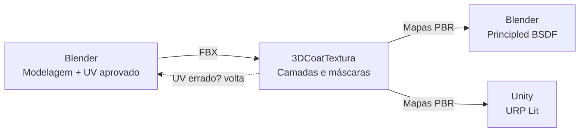

<!-- _class: cover -->
<!-- _paginate: false -->

# Texturização

## Profundidade direto da malha

**Semana 7** — Migração para o 3DCoatTextura: workflow Blender → 3DCoatTextura, mesh maps (AO, Curvature, Normal) e Smart Materials

<!--
Notas: Marcar a virada de ferramenta: o Blender deixa de montar o material e passa a só exportar a malha e receber os mapas de volta. O 3DCoatTextura entra como ferramenta dedicada — e as duas trilhas visuais passam a usar o mesmo fluxo de ferramenta a partir de hoje. Sem crítica formal — a CF2 é na Semana 8.
-->

---

## Onde vocês estão

Semana 6: Hero Asset com textura seamless aplicada ao Albedo, trilha visual já definida.

Hoje: a mesma malha vai para uma ferramenta nova — e gera profundidade sozinha, sem nós e sem high-poly.

<!--
Notas: Recapitular em uma frase. Não reabrir o conteúdo técnico de seamless da Semana 6 — isso já foi ensinado. Só situar a transição de ferramenta.
-->

---

Ao final da semana você será capaz de:

- Verificar se um modelo do Blender está pronto para exportar e corrigir os problemas mais comuns
- Exportar do Blender e importar o Hero Asset no 3DCoatTextura (Per-Pixel Painting, Metalness PBR)
- Reconhecer os espaços de trabalho do 3DCoatTextura 2026 (Paint Room e Render Room)
- Explicar o que são mesh maps (AO, Curvature, Normal) e por que dispensam high-poly
- Usar AO e Curvature como máscara de desgaste (condições + Smart Material + Fill)
- Pintar um Normal Map real no canal Depth e montar um material com Color, Roughness e Normal ativos

<!--
Notas: Os quatro primeiros objetivos são da mini aula; os demais são o trabalho prático da demonstração e do estúdio.
-->

---

<!-- _class: question -->

# De onde vem essa profundidade, se eu não pintei nada?

<!--
Notas: Bloco 1 (3 min). Mostrar 3 versões da mesma parede: (1) só Albedo (resultado da Semana 6), (2) com AO multiplicado por cima, (3) com Curvature também aplicado como máscara. Perguntar de onde vem a informação — conduzir a turma a perceber que é a própria geometria (reentrâncias, bordas, bevels), não uma imagem externa. Não responder por completo agora: a resposta volta no Bloco 5 e na demonstração.

[!FIGURA]
Objetivo didático — Evidenciar que AO e Curvature nascem da geometria, sem exigir high-poly nem pintura manual.
Arquivo sugerido — assets/parede_ao_curvature_comparacao.webp
Descrição — Três renders lado a lado da mesma parede de pedra: (1) só Albedo/textura seamless da Semana 6, (2) com mapa de AO multiplicado (reentrâncias mais escuras), (3) com Curvature também aplicado (arestas com desgaste/brilho diferenciado).
Como produzir — Renderizar no 3DCoatTextura (Render Room) o mesmo asset de demonstração em três estados de camada: só Color, Color+AO, Color+AO+Curvature.
-->

---

## Por que o 3DCoatTextura?

É a edição do 3DCoat **só de texturização**: sem escultura, sem retopologia, sem modelagem, sem UV Room.

**Paint Room** — onde vocês pintam: pincéis, stencils, alphas, camadas com máscara, em qualquer canal PBR.

**Render Room** — visualização em alta qualidade com HDR, para avaliar antes de exportar.

Regra da disciplina: **modelagem e UV se resolvem no Blender. O 3DCoatTextura só pinta.**

<!--
Notas: Bloco 2 (3 min). A conferência do UV importado é feita na janela Texture Editor, dentro do Paint Room. Se o UV precisar de correção, corrige-se no Blender e reexporta-se. Mencionar que a Pilgway oferece licença educacional/estudantil não comercial — confirmar as condições vigentes antes de divulgar.
-->

---

<!-- _class: diagram -->

## O pipeline: a seta só anda para a frente

UV errado não se corrige no 3DCoatTextura: volta para o Blender, reexporta e reimporta.

<!--
Notas: Bloco 3 (4 min). Percorrer o que entra e o que sai em cada etapa: Blender (malha low-poly, UV aprovado, transformações aplicadas) → FBX → 3DCoatTextura (.3b com camadas, mapas PBR exportados) → Blender/Unity (material montado). Por isso o UV do Hero Asset precisa estar aprovado antes de começar a pintar: mudar o UV depois obriga a reprojetar a pintura.
-->

---

<!-- _class: question -->

# Esse modelo está pronto para exportar? (1/4)

<!--
Notas: Bloco 4 (5 min para os 4 slides). Resposta: NÃO — a malha não tem UV (UV Editor vazio). O 3DCoatTextura não tem UV Room: abrir o UV no Blender antes de exportar (Smart UV Project para teste; seams manuais para entrega). Cenário 2.

[!FIGURA]
Objetivo didático — Reconhecer uma malha sem UV.
Arquivo sugerido — assets/quiz_k2_sem_uv.webp
Descrição — Print do Blender com o caixote K2_SemUV selecionado: UV Editor vazio e painel Object Data → UV Maps sem nenhuma entrada.
Como produzir — Gerar o kit com o script do roteiro do Kit de FBX com defeito e capturar a tela do K2 no Blender.
-->

---

<!-- _class: question -->

# Esse modelo está pronto para exportar? (2/4)

<!--
Notas: Resposta: DEPENDE — o modificador Mirror espelha a geometria sem deslocar o UV: as duas metades usam as mesmas ilhas (sobreposição). O que se pinta de um lado aparece no outro, e o AO calculado pode sair errado. Se a simetria for intencional (economia de texel), tudo bem — só não pintar detalhe assimétrico ali; se não for, separar as ilhas. Cenário 3.

[!FIGURA]
Objetivo didático — Reconhecer UV sobreposto gerado por Mirror.
Arquivo sugerido — assets/quiz_k3_uv_sobreposto.webp
Descrição — Print do Blender com o K3_UV_Sobreposto: viewport com os dois caixotes espelhados e painel de modificadores mostrando o Mirror (UV U desligado); UV Editor com uma só cópia das ilhas.
Como produzir — Capturar o K3 do kit no Blender, com o painel de modificadores aberto.
-->

---

<!-- _class: question -->

# Esse modelo está pronto para exportar? (3/4)

<!--
Notas: Resposta: NÃO — escala 100 e rotação não aplicadas. Chega gigante ou girado no 3DCoatTextura e na Unity. Correção: Ctrl+A → All Transforms. Cenário 9.

[!FIGURA]
Objetivo didático — Reconhecer transformações não aplicadas.
Arquivo sugerido — assets/quiz_k4_escala.webp
Descrição — Print do Blender com o K4_Escala_Rotacao selecionado e o painel N (Item) mostrando Scale 100 e rotação diferente de zero.
Como produzir — Capturar o K4 do kit no Blender com o painel N aberto.
-->

---

<!-- _class: question -->

# Esse modelo está pronto para exportar? (4/4)

<!--
Notas: Resposta: NÃO — o Array não foi aplicado. Se exportar com "Apply Modifiers" desligado, chega só 1 dos 3 caixotes; se aplicar, as cópias compartilham o mesmo UV (volta ao cenário 3). Correção: aplicar o modificador (ou marcar Apply Modifiers) e conferir o UV depois. Cenário 8. Fechar o bloco apontando a página "Cenários de Exportação Blender → 3DCoatTextura" no menu Recursos do site.

[!FIGURA]
Objetivo didático — Reconhecer modificador não aplicado.
Arquivo sugerido — assets/quiz_k5_modificador.webp
Descrição — Print do Blender com o K5_Modificador: viewport mostrando 3 caixotes e painel de modificadores com o Array (Count 3) ainda não aplicado.
Como produzir — Capturar o K5 do kit no Blender com o painel de modificadores aberto.
-->

---

<!-- _class: exercise -->

## Checklist de exportação

1. UV de textura **único, ativo, dentro de 0–1** (ou sobreposição intencional)
2. **Modificadores aplicados** e UV conferido depois de aplicar
3. **Ctrl+A → All Transforms**; normais e sharp edges definidos
4. Materiais decididos: **atlas** ou **um por peça**
5. **FBX**, só a low-poly — bakes vão como imagens à parte

<!--
Notas: Este slide fica projetado durante todo o estúdio. Os 10 cenários completos estão na página "Cenários de Exportação Blender → 3DCoatTextura" (menu Recursos).
-->

---

## Mesh maps: profundidade sem high-poly

**Ambient Occlusion (AO)** — mede o quanto cada ponto está "protegido" da luz ambiente. Reentrâncias escurecem, superfícies expostas clareiam.

**Curvature (Cavity)** — mede convexidade/concavidade. Arestas recebem um valor, frestas outro — é o mapa mais útil para simular desgaste de uso.

<!--
Notas: Bloco 5 (5 min para este slide e os dois seguintes). Frestas/cantos internos = mais escuros no AO (é onde sujeira e sombra de contato se acumulam). Arestas/quinas = onde a pintura descasca e o metal fica exposto — o oposto do que acontece nas reentrâncias. Responder agora a pergunta da abertura: a profundidade veio da geometria.
-->

---

## Normal Map: da pintura, não do ruído

Sem high-poly dedicado, o caminho é pintar micro-detalhe direto no canal **Depth** do 3DCoatTextura.

Entalhes, rachaduras, rebites — o software converte a profundidade pintada em Normal Map real na exportação.

AO e Curvature nascem da malha de jogo que vocês já modelaram — com os bevels e reentrâncias que ela já tem.

<!--
Notas: Diferença central em relação ao workflow tradicional de produções AAA: lá o Normal nasce da diferença high-poly/low-poly. Aqui, sem high-poly, o Normal nasce de pintura de profundidade. O Albedo da Semana 6 continua sendo a base de cor — o que muda é que Roughness, Normal e desgaste viram camadas e máscaras no 3DCoatTextura.
-->

---

## Duas trilhas, mesmo fluxo de ferramenta

**Fotorrealista:** a foto da Semana 6 entra como camada de Color. AO/Curvature reforçam sombra de contato e desgaste nas bordas por cima dela.

**Estilizada:** um Smart Material (ou camadas equivalentes) substitui a foto. Os mesmos AO/Curvature guiam onde a sujeira e o desgaste aparecem.

Nos dois casos, o resultado técnico é equivalente: Color + Roughness + Normal ativos, com máscara de AO/Curvature.

<!--
Notas: Quem já baixou uma textura estilizada pronta na Semana 6 usa essa imagem como ponto de partida da camada de Color, do mesmo jeito que a trilha fotorrealista usa a foto. Via alternativa (nós procedurais no Blender, Apostila Cap. 13): só mencionar como leitura complementar, não avaliada — não há tempo para o panorama nesta mini aula.
-->

---

<!-- _class: summary-slide -->

# Resumo

- **Modelagem e UV no Blender**; o 3DCoatTextura só pinta — o checklist decide se o modelo está pronto
- **AO e Curvature** nascem da geometria — sem high-poly, sem imagem externa
- **Normal** vem de pintura no canal Depth, não de nós procedurais
- **Duas trilhas, mesmo fluxo**: foto ou Smart Material, guiados pela mesma máscara

<!--
Notas: Fechar a mini aula amarrando os conceitos antes da demonstração. Hoje é observação — a CF2 avalia o material completo na Semana 8.
-->

---

## Agora: demonstração

Checklist e exportação no Blender → importação e Texture Editor → textura da Semana 6 como Color.

Calcular AO e Curvature, aplicar a máscara com **Smart Material + Fill**, pintar o primeiro Normal via Depth, Roughness guiado por Curvature.

<!--
Notas: Transição para os 20 min de demonstração. Ter os arquivos de segurança (.3b de cada etapa) prontos na pasta [DEMO]_3DCoat_Exportacao/: se o 3DCoatTextura travar, abrir o da etapa seguinte e continuar. Passo a passo no plano de aula (Passos 1–6).

[!FIGURA]
Objetivo didático — Mostrar a sequência do fluxo de migração Blender → 3DCoatTextura até o material com três canais ativos.
Arquivo sugerido — assets/demo_3dcoat_bake_workflow.webp
Descrição — Sequência de 4 capturas de tela do 3DCoatTextura lado a lado: malha recém-importada sem textura, com camada de Color aplicada, com AO/Curvature aplicados como máscara de desgaste, e com as primeiras marcas de Normal pintadas no Depth.
Como produzir — Capturar no 3DCoatTextura usando o asset de demonstração do professor (parede simples com textura seamless da Semana 6), salvando cada etapa do Paint Room.
-->

---

## Attach × Fill: o momento "não aconteceu nada"

**Attach** (botão direito no Smart Material → *Attach to the current layer*) diz **o quê** a camada mostra.

**Fill** ou pincel diz **onde**: a condição (*More on Shadow*, *More on Convex*) é calculada no clique.

Mudou a condição, o Degree ou o Contrast? **Limpe a camada e preencha de novo.**

Teste a condição com **vermelho puro** antes de escolher a cor definitiva.

<!--
Notas: Mostrar de propósito, durante o Passo 4 da demonstração: prender o material com Attach → nada aparece → perguntar "por que não aconteceu nada?" → usar o Fill → o vermelho aparece só nas reentrâncias. Depois mudar o Degree, salvar, e mostrar que nada muda até limpar a camada e preencher de novo. É exatamente onde a turma vai travar no estúdio — ver na demonstração economiza atendimento. Pré-requisito: Edit → Calculate Occlusion / Calculate Curvature.
-->

---

<!-- _class: chapter -->

07

# Produção em estúdio

Do Blender ao 3DCoatTextura: clínica de exportação e migração do Hero Asset Referência

<!--
Notas: Divisória entre a mini aula e o estúdio. Os slides a seguir ficam projetados durante a produção — servem de consigna e timebox visíveis, apresentados um a um conforme a etapa correspondente começa. O slide do checklist pode ser reprojetado a qualquer momento.
-->

---

<!-- _class: exercise -->

## Clínica de exportação — em duplas

**≈10 minutos.**

Cada dupla recebe um FBX do kit (K1–K6). Alguns têm defeito — talvez o seu não tenha.

1. Importem no 3DCoatTextura e descrevam o **sintoma**.
2. Encontrem o **cenário** na página *Cenários de Exportação* (menu Recursos).
3. Corrijam no Blender, reexportem e confirmem no 3DCoatTextura.

<!--
Notas: Gabarito no roteiro do Kit de FBX com defeito (menu Recursos). Nos 2 últimos minutos, duas duplas contam sintoma → causa → correção. Quem recebe o K1 (controle, sem defeito) também tem uma resposta válida: "não há nada a corrigir" — e precisa justificar com o checklist.
-->

---

<!-- _class: exercise -->

## Etapa 1 — Exportar e importar o Hero Asset

**≈8 minutos.**

Passem o **checklist** (slide projetado) e exportem o Hero Asset do Blender em `.fbx`, com UV.

Importem no 3DCoatTextura: Per-Pixel Painting, workflow Metalness PBR, resolução 1024×1024. Confiram o UV no **Texture Editor**.

<!--
Notas: Encontro 1. Em computadores mais lentos, orientar para 512×512. Se o UV estiver errado: voltar ao Blender — não tentar corrigir no 3DCoatTextura.
-->

---

<!-- _class: exercise -->

## Etapa 2 — Camada de Color

**≈8 minutos.**

Trilha fotorrealista: tragam a textura seamless da Semana 6 como camada base de Color.

Trilha estilizada: apliquem um Smart Material (ou montem camadas equivalentes).

<!--
Notas: Verificar se a base de Color está alinhada ao UV — se saiu distorcida, conferir se o UV exportado é o mesmo usado na criação da textura.
-->

---

<!-- _class: exercise -->

## Etapa 3 — AO/Curvature + desgaste

**≈12 minutos.**

*Edit → Calculate Occlusion* e *Calculate Curvature*.

Camada vazia + Smart Material com condição (*More on Shadow* para sombra, *More on Convex* para arestas) → **Attach + Fill**. Camada em Multiply sobre o Color.

AO/Curvature são sempre camada auxiliar por cima da base — nunca a cor final. Mudou a condição? Limpe e preencha de novo.

<!--
Notas: Erros comuns: aplicar o AO direto no canal Color, apagando a base; esquecer de ocultar a camada AmbientOcclusion gerada pelo cálculo (sombra em dobro); prender o material e não preencher. Sugerir o teste com vermelho puro.
-->

---

<!-- _class: exercise -->

## Etapa 4 — Roughness e Normal via Depth

**≈12 minutos.**

Roughness: Fill base + camada guiada por Curvature (arestas mais polidas).

Normal/Depth: pintem 2–3 marcas de profundidade (rachaduras, entalhes) coerentes com o tema.

Salvem: `[Nome]_HeroAsset_3DCoat_S07.3b`.

<!--
Notas: Meta do estúdio de hoje: pelo menos três canais ativos (Color, Roughness, Normal). Perguntar: "essas marcas de profundidade contam uma história? Onde esse objeto seria mais golpeado no universo do kit?"
-->

---

<!-- _class: exercise -->

## Crítica coletiva informal — 20 minutos

**Rodada circulante, 4–5 estações.**

Em cada estação: mostrem o **liga/desliga** da camada de máscara (antes/depois).

O desgaste das arestas parece físico? As reentrâncias escurecem de forma crível? O Smart Material responde à geometria, ou parece só colado por cima?

<!--
Notas: Abertura do Encontro 2. A discussão parte da comparação antes/depois, não da descrição. Fechar nomeando o erro mais comum (tipicamente opacidade excessiva da máscara, ou máscara não conectada ao modo de mistura correto) e o estado geral das duas trilhas.
-->

---

<!-- _class: exercise -->

## Fechamento dos três canais — ≈30 minutos

Quem ainda não completou: revisem Color (alinhado, coerente com a trilha), Roughness (guiado por Curvature) e Normal (2–3 marcas coerentes com o tema).

Salvem: `[Nome]_HeroAsset_3DCoat_S07.3b` (atualizado).

<!--
Notas: Prioridade de quem ainda não tem os três canais ativos. Quem já está satisfeito pode seguir direto para o aprofundamento.
-->

---

<!-- _class: exercise -->

## Aprofundamento — tempo restante

Reforcem o Normal com uma segunda camada de Depth em escala menor (micro sobre macro).

Ou testem um Smart Material diferente e comparem visualmente. Ou explorem o canal Subsurface, se houver elemento orgânico (sem cobrança — o SSS é formalizado na Semana 8).

<!--
Notas: Para quem já tem os três canais fechados. Alternativa: comparar a máscara por condição com o nó SimpleMask do Node System (3DCoatTextura 2026), ou com a técnica de nós procedurais do Blender (Apostila, Cap. 13), em uma segunda superfície.
-->

---

<!-- _class: exercise -->

## Antes de sair

Confirmem as entregas de hoje:

- Hero Asset no 3DCoatTextura com **Color + Roughness + Normal ativos** (`_HeroAsset_3DCoat_S07`)
- Screenshot do painel de **Layers** (camadas nomeadas)
- Screenshot comparativo **antes/depois** das máscaras de AO/Curvature e do Normal

Para estudar: menu **Recursos** do site — *Cenários de Exportação*, *Features por Trilha* (vídeo da sua trilha) e, para quem conhece o Substance, o *Guia de Migração*.

Sem crítica formal hoje. Na semana que vem: **CF2** — apresentem esse material explicando a trilha e as decisões de máscara.

<!--
Notas: Fechamento (10 min): "Hoje vocês montaram um material PBR completo pela primeira vez dentro do 3DCoatTextura — com profundidade vinda da própria malha e do pincel, não de nós matemáticos." Ponte: na Semana 8 o material é refinado e exportado com os quatro mapas PBR completos.
-->
